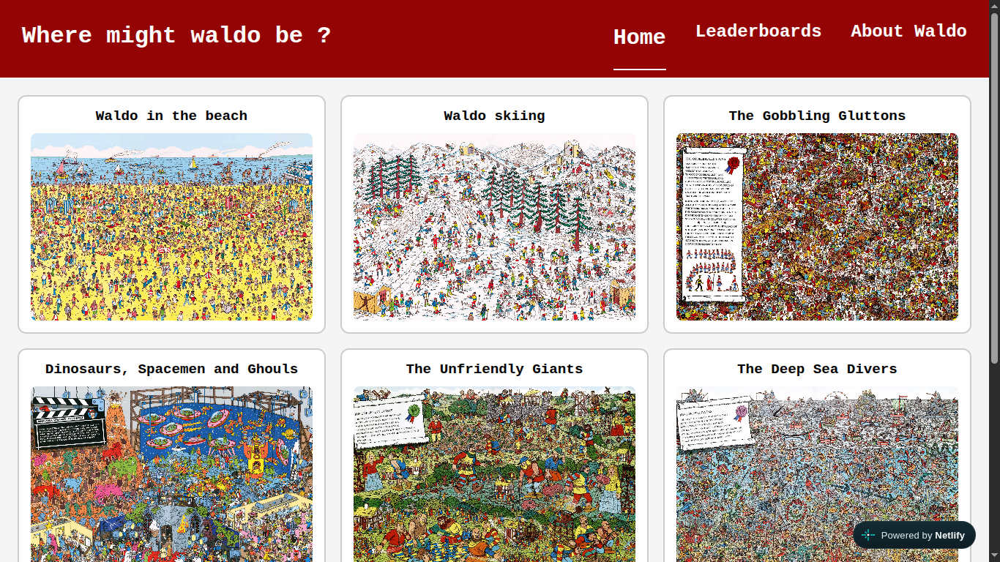
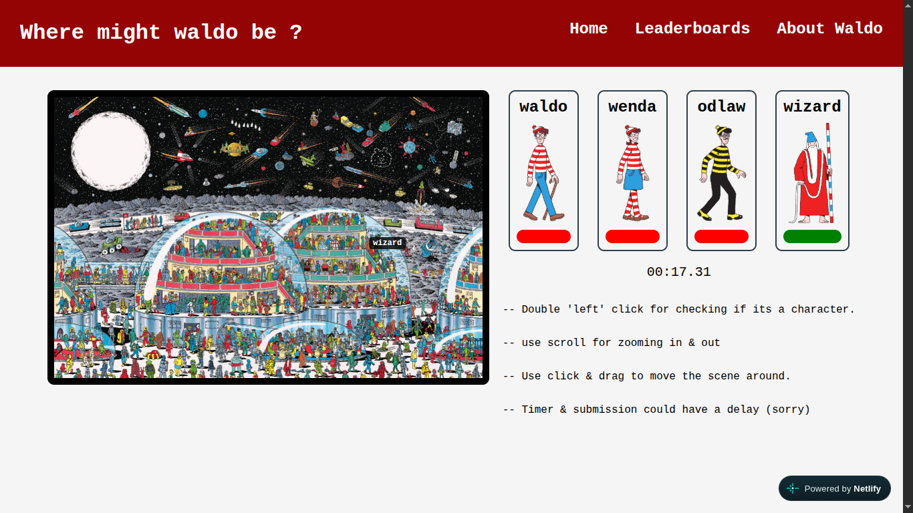
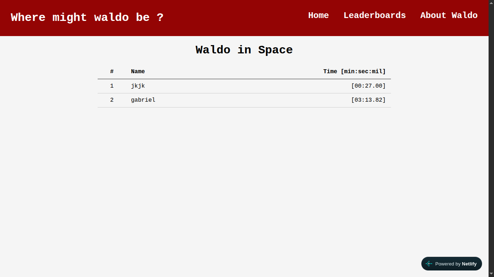

# Where might waldo be ?







A photo tagging app where you find waldo & his friends (or foe) . 


[Live site link](https://where-might-waldo-be.netlify.app/)

[Backend repo link](https://github.com/jk301/waldo-api)

[Frontend repo link](https://github.com/jk301/waldo-front)

## Disclaimer

- Backend is running on render (free-tier) which can have a bit of a cold start (could take 40-60 sec). Please be patient :) .


## Usage

1. No user account needed! just choose the scene & start playing!
2. If you completed one of the scene, you can add your name on the leaderboard (if you want to).

## Features

- Backend time tracking
- Used react-zoom-pan-pinch module for dynamic zoom-ins & dragging of the scene.


## Installation

### Back-end setup

```
git clone https://github.com/jk301/waldo-api.git
```

```
cd waldo-api
```

```
npm install
```

- create an env that will need a database(prisma postgres) link.
- A client URL for CORS, (Which is hard coded here in app.js) example > http://localhost:5173/

```
npx prisma generate
```

```
npx prisma migrate dev
```

and finally 

```
node app.js
```


### Front-end setup

```
git clone https://github.com/jk301/waldo-front.git
```

```
cd waldo-front
```

```
npm install
```

- create a env file that has a api url (VITE_API_URL) that needs backend URL to send requests. 
- example: http://localhost:3000

and run 

```
npm run dev
```